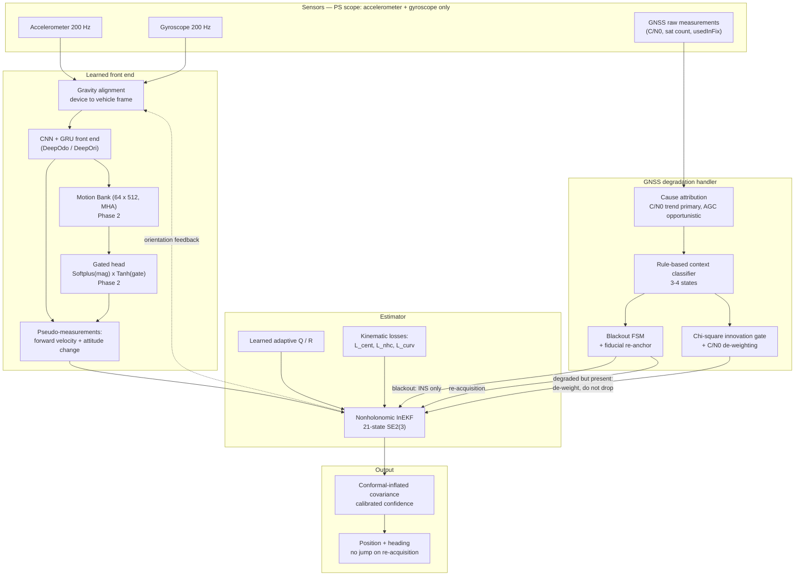
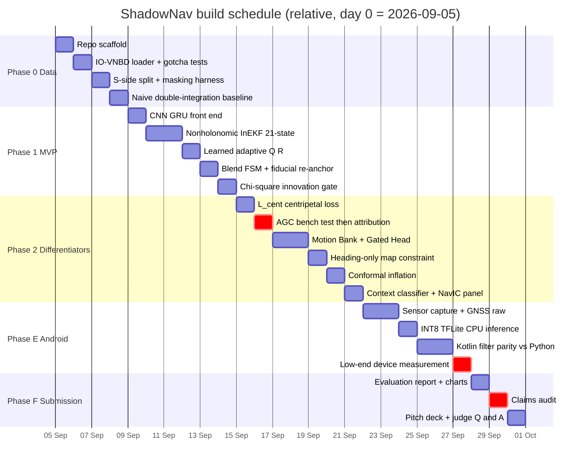

# SIH26168 — Response to External Review

**Date:** 2026-09-05
**Reviewed document:** an unattributed external evaluation scoring the project **7.5/10** across 15 dimensions, recommending ZUPT, map matching, magnetometer/optical-flow additions, and a dataset-collection campaign.
**System actually under test:** [PLAN.md](../PLAN.md) revision 2 (2026-09-05), §2 architecture and §3 claims.

Companion documents: [research dossier](SIH26168-dead-reckoning-research.md) · [open-track findings](SIH26168-open-track-findings.md)

---

## 1. Verdict

**Discard the scorecard; harvest four recommendations.** The document evaluates *pedestrian* dead reckoning — step detection, stride length, gait variation, foot-stance ZUPT, treadmill validation, "phone in hand vs pocket" — against a project that is unambiguously *vehicle* dead reckoning through GNSS blackouts, validated on IO-VNBD ([PLAN.md:13](../PLAN.md#L13)). Its headline recommendation, "implement Zero-Velocity Updates when the foot is stationary," is not merely suboptimal here; the vehicle-domain literature this project is built on states the opposite explicitly. It also never saw the solution — "presumably", "appears to", "we assume", "likely" recur throughout — so all fifteen scores are assigned to a hypothetical, and the headline 7.5 is not reproducible from its own table (the unweighted mean of its published scores is **5.93**, and no weights are given). Two of its lowest scores rest on the false premise that no dataset exists.

It is not worthless. Four of its axes — **latency, power/compute, reproducibility, and privacy/data-retention** — are genuine gaps in PLAN.md that had no owner before this review, and its instinct that demo-day risk deserves a named fallback is correct. Those are adopted below. Everything else is either already in the plan, already rejected with a documented reason, or actively harmful to follow.

**Corrected score, on the published rubric in §5: 4.1/10 today, 6.2/10 at Phase 1 MVP complete.** Both numbers are lower than the reviewer's 7.5, and that is the honest position: as of this writing the repository contains a plan, three research documents and a presentation demo, and zero lines of estimator code.

---

## 2. Defect table

`file:line` references are to this repository. Severity: **CRITICAL** invalidates a conclusion · **HIGH** invalidates a score or recommendation · **MEDIUM** misleads · **LOW** cosmetic.

| # | Defect | Severity | Refutation |
|---|---|---|---|
| a | **Evaluates pedestrian DR, not vehicle DR.** Step detection, stride-length calibration, gait patterns, foot-stance ZUPT, treadmill testing, "carrying phone in hand vs pocket", "climbing stairs". | **CRITICAL** | [PLAN.md:13](../PLAN.md#L13) — "a smartphone-only … **vehicle** dead-reckoning system". [CLAUDE.md](../CLAUDE.md) — "dead-reckon a **vehicle's** position through GPS blackouts (tunnels, multi-level parking, urban canyons)". Validation is IO-VNBD, a vehicle dataset. |
| b | **Scores a solution it never read.** "the *provided* solution (presumably using smartphone or wearable IMUs)"; "According to documentation, their system…"; "The architecture **likely** follows…". | **CRITICAL** | Every one of the fifteen scores is conditioned on an assumption the document itself flags. There is no evidence any repository artifact was opened. |
| c | **False premise: no dataset exists.** "No specific dataset was provided… the team has to collect it." Drives *Data Requirements = 3* and *Training Needs = 4*, the two lowest scores in the table. | **CRITICAL** | [dossier §3](SIH26168-dead-reckoning-research.md); [PLAN.md:149](../PLAN.md#L149). IO-VNBD is selected, CC BY 4.0 via its *Data in Brief* version, with all four parsing gotchas, the misspelled folder, the Git-LFS media-URL path and the 10 Hz/1 Hz rate mismatch documented in advance ([open-track Track H](SIH26168-open-track-findings.md)). GSDC, comma2k19, KITTI, OxIOD, RIDI and RoNIN are also surveyed. |
| d | **Five comparanda are unverifiable.** RouteIQ, ANTRUM, EMBER, NAVIX, RatNav — specific placements and dates ("UniHack 2026", "MakeNJIT 2026", "3rd place"), zero URLs, sourced to "LinkedIn reports". | **CRITICAL** | [dossier §10](SIH26168-dead-reckoning-research.md) holds ~14 **verified** live SIH26168 repos ranked by inspected technical maturity; [§11](SIH26168-dead-reckoning-research.md) covers international prior art and reports the empty categories as empty rather than padding them. Quoting an unsourced hackathon result to an ISRO judge is a live credibility risk. |
| e | **The headline score is not reproducible from its own table.** Stated overall **7.5**; unweighted mean of the fifteen published scores is **5.93**; weights are asserted ("giving extra weight to…") but never published. | **HIGH** | Arithmetic on the document's own Ratings Summary: 7+7+8+6+5+5+7+5+3+4+7+5+6+6+8 = 89; 89/15 = 5.93. |
| f | **Recommends work already in the plan or already rejected there with reasons.** Map matching, magnetometer, barometer, dataset collection, TFLite quantization, on-device privacy, demo clarity. | **HIGH** | See the translation table in §3. Nine of its recommendations are `ALREADY-IN-PLAN`, five are `REJECTED-WITH-REASON` upstream. |
| g | **Both Mermaid blocks fail to parse.** `F[Orientation & Position Estimation (Kalman Filter / ML)]` and `G[Error Correction (ZUPT, Map Matching)]` — unquoted parentheses inside node labels are a Mermaid syntax error. | **LOW** | Reproduced locally. Both render as error boxes. Fixed form in §6. |
| h | **Timeline is stale and incoherent.** Gantt opens 2025-08-01, marks tasks `done`, and runs ~300 days. | **HIGH** | Today is 2026-09-05. [PLAN.md:147–169](../PLAN.md#L147) is a **day-scale** plan: Phase 0 is day 1–2, Phase 1 is day 2–5. A 300-day schedule is off by two orders of magnitude against a hackathon. |
| i | **The single headline recommendation is the one thing the literature says does not transfer.** "Implement ZUPT or Similar Resets… adding zero-velocity updates when the foot is stationary dramatically curbs drift." | **CRITICAL** | [dossier §1.2](SIH26168-dead-reckoning-research.md), quoting GNIO's own §V verbatim: *"unlike pedestrian navigation, where frequent stops help reset drift via ZUPT, continuous high-speed driving lacks such constraints."* Vehicle DR's hardest case is constant-speed cruising, where no zero-velocity event ever occurs. |
| j | **Omits the most important empirical fact in the domestic field**, then recommends the failure mode it describes. "Apply advanced ML (e.g. LSTM networks) to learn motion patterns." | **CRITICAL** | [dossier §10](SIH26168-dead-reckoning-research.md), Agastya's own published ablation: unconstrained "Full AI" correction scores **2.76 m ATE — worse than their classical baseline at 1.64 m**. Only the *gated* policy wins (1.61 → 1.42 m). More model capacity is not the lever; the gating/confidence logic is. |
| k | **Internally inconsistent scoring.** *Sensor Fusion = 8* is the highest non-deployment score, justified by "Good use of multi-sensor fusion **is assumed**". Meanwhile *Complexity = 5*, *Power = 5* and *Deployment Feasibility = 8* score the same unmeasured property three different ways. | **HIGH** | A score cannot be simultaneously the most confident and the most assumed. No rubric anchors are published for any axis. |
| l | **Several recommendations violate the PS's sensor scope.** Magnetometer corrections, barometric altimeter, "low-cost optical flow sensors". | **HIGH** | [PLAN.md:13](../PLAN.md#L13) — accelerometer + gyroscope, no external speed sensor. Optical flow additionally requires a camera, is useless in an unlit tunnel, and is thermally unaffordable on the low-end hardware this project now targets (§4). |
| m | **The prescribed calibration routine is physically impossible in the target scenario.** "Calibration routines (e.g. figure-8 rotations for gyro bias) should be built in." | **HIGH** | The phone is mounted in a moving vehicle. [PLAN.md:33–36](../PLAN.md#L33) requires *opportunistic* calibration during turns and speed changes, precisely because [PLAN.md:191](../PLAN.md#L191) identifies a straight constant-speed tunnel approach as the degenerate-excitation worst case. |
| n | **No mention of licence or provenance risk.** *Reproducibility = 6* is assigned without it. | **HIGH** | [PLAN.md:194](../PLAN.md#L194) — the DragonEmperorG repos (`QDeepOdo`, `QAIIMUDeadReckoning`), which are the obvious things to copy, are **unlicensed / all-rights-reserved**. Vendoring them into an ISRO submission is a disqualifying risk. The plan builds on `mbrossar/ai-imu-dr` (MIT) instead. |
| o | **No mention of freedom-to-operate.** | **MEDIUM** | [open-track Track G](SIH26168-open-track-findings.md) — STMicroelectronics **US11199410B2** is granted, in force, covers phone-in-arbitrary-orientation misalignment, and its specification explicitly names tunnels and urban canyons. The design-around (learn the misalignment rather than determine axes explicitly) is a real constraint on the architecture. |
| p | **The risk register's conclusion does not follow from its contents.** Top risk is rated *High* with a mitigation (foot-stance ZUPT) that does not apply; conclusion is "Overall risk is moderate." | **MEDIUM** | Removing the inapplicable mitigation leaves the highest-rated risk unmitigated, which cannot aggregate to "moderate". |
| q | **Overstates its own certainty about the problem statement, in both directions.** Quotes a one-line title as "the official brief", asserts "no maps or landmarks are indicated", then builds fifteen scores on it. | **MEDIUM** | [PLAN.md:202](../PLAN.md#L202) records the verbatim PS text as an **open question** with two conflicting accounts of the named scenarios. The honest position is that the scenario list is unresolved. |
| r | **Dangling figure reference.** "The architecture likely follows a pipeline similar to that in Figure 1", followed by a caption for a figure that is not present. | **LOW** | No image in the document. |

**Self-check on the eight defects listed in the review request.** All eight are confirmed. None were wrong. Ten further defects (i–r) were found, of which four are CRITICAL — items i and j are the most consequential, because acting on the document's two headline recommendations would move the project *away* from the architecture the evidence supports.

---

## 3. PDR → Vehicle translation table

Every recommendation and diagnostic in the reviewed document, mapped to its vehicle-domain equivalent and tagged.

| # | Reviewer's item (pedestrian framing) | Vehicle-domain equivalent | Where it lives | Tag |
|---|---|---|---|---|
| 1 | ZUPT on foot stance | **Stop-detected ZUPT + nonholonomic constraint** `L_nhc = ‖v̂_lat‖² + ‖v̂_up‖²` — wheelbase-free, applies at *every* timestep, not only at stops | [PLAN.md:100–106](../PLAN.md#L100) | `ALREADY-IN-PLAN` |
| 2 | Step detection → stride length → distance | **Centripetal-consistency speed observability** `L_cent = ‖a_y − v̂·ω_z‖²`. Rearranged, `v = a_y/ω_z`: every turn during a blackout becomes an independent speed observation not built on integrating accelerometer noise | [PLAN.md:94–99](../PLAN.md#L94) | `ALREADY-IN-PLAN` (Phase 2, first) |
| 3 | Gait recognition / slope compensation | **Ackermann curvature + friction bounds**, gated off above ~0.5 g lateral where tyre slip breaks the bicycle model | [PLAN.md:104–108](../PLAN.md#L104) | `ALREADY-IN-PLAN` |
| 4 | Map matching to re-anchor position | **Heading-only, gated, hysteretic** map constraint — never lateral | [PLAN.md:86](../PLAN.md#L86) | `ALREADY-IN-PLAN` |
| 5 | *Tightly-coupled* map/landmark correction as a novelty | — | Not novel (Fouque 2008); wrong match corrupts the filter; **multi-storey car parks have no OSM road network at all** — OSM terminates service roads at the entrance, and car parks are a PS-named scenario | `REJECTED-WITH-REASON` [PLAN.md:193](../PLAN.md#L193) |
| 6 | WiFi/BLE fingerprints for periodic re-anchoring | — | No fingerprint database exists for highway tunnels; requires infrastructure. The positioning argument in [PLAN.md:15–17](../PLAN.md#L15) rests on needing **no** infrastructure — this recommendation would forfeit it | `REJECTED-WITH-REASON` |
| 7 | Magnetometer / compass corrections | — | Outside the PS sensor scope ([PLAN.md:13](../PLAN.md#L13)). A magnetometer inside a steel vehicle body is corrupted by the vehicle's own ferrous mass and electrical transients, and by rebar in tunnels. **IO-VNBD's S-side does carry magnetic-field XYZ**, so it is cheap to test — but as a falsification ablation, not a design commitment | `GENUINELY-NEW` → *ablation only, low priority* |
| 8 | Barometric altimeter | Garage-ramp vs level-tunnel discriminator | Plausible and consistent with published barometer use, but **no paper validates that specific discriminator**, and `Sensor.TYPE_PRESSURE` is absent on many low-end devices — which is now a hard constraint (§4) | `GENUINELY-NEW` → *design hypothesis, must be optional* |
| 9 | Low-cost optical flow sensors | — | Requires a camera; useless in an unlit tunnel; thermally and power-wise unaffordable on low-end hardware; outside PS scope | `REJECTED-WITH-REASON` |
| 10 | Figure-8 rotation for gyro-bias calibration | **Opportunistic calibration during turns and speed changes** | Phone is mounted in a moving vehicle; a user-performed figure-8 is impossible. Fixed pre-blackout windows are the degenerate case | `REJECTED-WITH-REASON` [PLAN.md:33–36](../PLAN.md#L33), [PLAN.md:191](../PLAN.md#L191) |
| 11 | Collect and open-source a labelled IMU dataset | — | Duplicative: IO-VNBD is CC BY 4.0 and already covers 3 phone models × 4 vehicles × 3 countries | `REJECTED-WITH-REASON` |
| 11b | *(the surviving sliver of 11)* | **Two-wheeler collection** — the one genuinely absent data class | [PLAN.md:142](../PLAN.md#L142), [PLAN.md:195](../PLAN.md#L195) — most differentiated angle, least data | `ALREADY-IN-PLAN` as a known risk |
| 12 | "Apply advanced ML (e.g. LSTM)" | **CNN+GRU front end** + GNIO **Motion Bank** and **Gated Prediction Head** | [PLAN.md:75](../PLAN.md#L75), [PLAN.md:82](../PLAN.md#L82). Superseded — and per defect (j), *more capacity is the wrong lever*; gating is the lever | `ALREADY-IN-PLAN`, superseded |
| 13 | Edge-NPU / AI accelerators for heavier models | — | Inverted under the low-end target (§4). NNAPI is deprecated as of Android 15 and behaves inconsistently across low-end SoCs; **INT8 on CPU is the portable path** | `REJECTED-WITH-REASON` (new, §4) |
| 14 | TensorFlow Lite / quantize networks | Same | [PLAN.md:113](../PLAN.md#L113). Note the dossier's finding that a competitor's ATE *improved* under INT8 (1.61 → 1.42 m) — worth replicating, not just a size win | `ALREADY-IN-PLAN` |
| 15 | Treadmill test on a known path to quantify drift | **IO-VNBD replay with synthetic GPS masking** on a documented S-side split | [PLAN.md:149–151](../PLAN.md#L149), [PLAN.md:169](../PLAN.md#L169) | `ALREADY-IN-PLAN` |
| 16 | Fully on-device, no cloud upload | Same | [PLAN.md:145](../PLAN.md#L145) — and genuinely necessary, since there is no network in a tunnel | `ALREADY-IN-PLAN` |
| 17 | Focus on demo clarity; live app showing tracked path | Same | Built: [demo/gnss-demo.html](../demo/gnss-demo.html) | `ALREADY-IN-PLAN`, done |
| 18 | **Explicit power / thermal budget** | Per-hour battery drain and sustained-load thermal behaviour, measured | **PLAN.md has no power budget.** Real gap | `GENUINELY-NEW` → **adopt** |
| 19 | **Explicit latency budget** | Inference + filter step inside the 10 Hz update budget, measured on target hardware | PLAN.md implies real-time but sets no number | `GENUINELY-NEW` → **adopt** |
| 20 | **Reproducibility as an enforced property** | Seeded determinism, committed splits, tests that fail on drift | PLAN.md implies it; nothing enforces it | `GENUINELY-NEW` → **adopt as a CI gate** |
| 21 | **Data-retention / encryption policy for logged trajectories** | On-device only is stated; retention, encryption-at-rest and deletion are not | Real gap, small cost | `GENUINELY-NEW` → **adopt** |
| 22 | **Named demo-day fallback** (pre-recorded trajectory if live fails) | Same | Sensible risk control; the WebGL demo already exists as one, but this should be explicit | `GENUINELY-NEW` → **adopt** |

**Buildable verdicts on the six `GENUINELY-NEW` items**, in the style of the open-track findings:

| Item | Verdict | Cost | Notes |
|---|---|---|---|
| 18 · Power/thermal budget | **BUILDABLE, required** | ~0.5 day | Blocked on a physical device. Must be measured, not modelled. |
| 19 · Latency budget | **BUILDABLE, required** | ~0.5 day | Set the number now (§4); measure in Phase E. |
| 20 · Reproducibility gate | **BUILDABLE, required** | ~2 h | Seeded RNG + a golden-trajectory regression test. Cheapest item on this list. |
| 21 · Retention/encryption policy | **BUILDABLE** | ~2 h | Android `EncryptedFile`; a documented retention default. |
| 22 · Demo fallback | **BUILDABLE** | ~1 h | Record a canonical run; wire a replay switch. |
| 7 · Magnetometer ablation | **BUILDABLE, low priority** | ~2 h | Falsification only. Do not ship it if it wins by less than noise — it costs PS-scope purity. |
| 8 · Barometer discriminator | **BUILDABLE, gated** | ~0.5 day | Must degrade gracefully when `TYPE_PRESSURE` is absent. Present as a hypothesis, never as a cited result. |

---

## 4. Resolved: target hardware class

**Decision (2026-09-05): the target is the low-end Android phone.** This closes half of [PLAN.md §7 open question 4](../PLAN.md#L205) and forces four architectural consequences, recorded here because they change the scorecard:

1. **AGC-based jamming attribution drops to fallback-only.** `GnssMeasurementsEvent.getGnssAutomaticGainControls()` is **API 33** ([PLAN.md:123](../PLAN.md#L123)). Low-end devices in service are routinely API 29–31. Combined with the already-open risk that AGC may go silent in a tunnel ([PLAN.md:128](../PLAN.md#L128)), **C/N₀-trend attribution becomes the primary path and AGC becomes an opportunistic enhancement.** This is a downgrade of PLAN §3.3's claim strength and should be reflected in the pitch.
2. **No NNAPI dependency.** Deprecated in Android 15 and inconsistent on low-end SoCs. INT8 TFLite on CPU with XNNPACK is the portable path — which the dossier's quantization finding already supports.
3. **Barometer must be optional.** `TYPE_PRESSURE` absence is common on low-end hardware.
4. **Compute budget is now binding.** GNIO's 0.08 GFLOPs at ~4.9 M parameters ([dossier §1.2](SIH26168-dead-reckoning-research.md)) is the reference envelope; the deployed model must not exceed it.

**Budgets set now, to be measured in Phase E:**

| Budget | Target | Rationale |
|---|---|---|
| Inference + filter step | **< 30 ms** per 10 Hz update | Leaves 70 ms headroom in the 100 ms budget on a slow core |
| Model size (INT8) | **≤ 5 MB** | APK footprint on entry-level storage |
| Peak RSS | **≤ 150 MB** | 2 GB-RAM devices with an aggressive low-memory killer |
| Battery drain | **≤ 6 %/hour** sustained | A 2-hour drive must not exceed ~12 % |
| Sustained thermal | no throttle over **30 min** | Longer than any realistic tunnel or car-park transit |
| Minimum API | **29** (Android 10) | NavIC enumeration (`CONSTELLATION_IRNSS`) lands at 29 — the floor is set by the feature we actually want |

---

## 5. Corrected scorecard

### 5.1 Method

- **System under test:** [PLAN.md](../PLAN.md) §2 architecture and §3 claims. Nothing else. Where the plan specifies but has not built, that is scored as *specified, unbuilt* — not as delivered.
- **Rubric anchors**, applied to every axis: **0** = absent or actively wrong · **5** = credibly specified with a cited basis, unmeasured · **10** = measured on held-out data and competitive with the best published reference in [PLAN.md §5](../PLAN.md#L173).
- **Aggregation:** `total = Σ(weightᵢ × scoreᵢ) / 100`. Weights sum to exactly 100 and are published below. The headline number is arithmetically reproducible from the table — this is the property the reviewed document lacks.
- **Two columns:** *Today* (2026-09-05, zero estimator code) and *At Phase 1 MVP* ([PLAN.md:153](../PLAN.md#L153) complete). The delta is the argument for the build plan.

### 5.2 The table

| # | Axis | W | Today | @MVP | Basis |
|---|---|---|---|---|---|
| 1 | DR positional accuracy through blackout | 12 | 2 | 6 | Architecture copied from a system with a published 0.64 % / 578 m field result ([PLAN.md:177](../PLAN.md#L177)); nothing measured yet |
| 2 | **Blend-back discontinuity on re-acquisition** | 10 | 3 | 7 | The PS's literal grading criterion ([PLAN.md:169](../PLAN.md#L169)). FSM + fiducial re-anchor specified ([PLAN.md:78](../PLAN.md#L78)); two wrong spring formulations already caught and documented in [demo/README.md](../demo/README.md) — real de-risking |
| 3 | Sensor drift / bias correction | 8 | 3 | 7 | 21-state InEKF carries explicit gyro/accel bias states ([PLAN.md:76](../PLAN.md#L76)) |
| 4 | Outage detection & re-acquisition latency | 5 | 3 | 6 | FSM specified; no latency measured. 2.14 s transition delay is the published benchmark to beat |
| 5 | **Urban-canyon NLOS handling** | 6 | 4 | 6 | Correctly identified as a *distinct* problem — GNSS lies rather than disappears ([PLAN.md:139](../PLAN.md#L139)). Most competitors' pure outage FSM never fires here. Chi-square gate is MVP-scoped |
| 6 | **Covariance calibration / NEES honesty** | 6 | 5 | 6 | Unusually strong for an unbuilt system: the plan forbids "guaranteed", requires reporting NEES, and pre-empts exchangeability ([PLAN.md:140](../PLAN.md#L140)) |
| 7 | Algorithmic approach & novelty | 7 | 6 | 6 | Four novelty claims already killed by verification; the survivors are narrowed and defensible ([PLAN.md:132–145](../PLAN.md#L132)). Score does not rise at MVP because MVP builds known components |
| 8 | Sensor fusion design | 5 | 5 | 7 | InEKF on SE₂(3) + learned adaptive Q/R, both verified from source ([dossier §1.1](SIH26168-dead-reckoning-research.md)) |
| 9 | **Evaluation-protocol validity** | 6 | 6 | 8 | WhONet's non-reproducibility smartphone-only was identified *before* building ([PLAN.md:151](../PLAN.md#L151)); synthetic-masking-only is a documented constraint, not a discovered surprise |
| 10 | Data availability & provenance | 5 | 8 | 8 | Directly contradicts the reviewer's 3/10. IO-VNBD selected, CC BY 4.0, all parsing hazards pre-documented |
| 11 | Training feasibility | 4 | 6 | 7 | ~5 M-parameter models, CPU-trainable; contradicts the reviewer's 4/10 |
| 12 | On-device latency (10 Hz budget) | 5 | 3 | 4 | Budget now set (§4) but unmeasured; MVP is Python-only |
| 13 | **Compute / power on low-end hardware** | 5 | 2 | 3 | Newly binding constraint (§4); no measurement possible until Phase E |
| 14 | Cross-device generalization | 4 | 2 | 4 | IO-VNBD spans 3 phone models, which helps; TTA is Phase 3 ([PLAN.md:90](../PLAN.md#L90)) |
| 15 | Two-wheeler coverage | 3 | 1 | 1 | The most differentiated claim with the least data ([PLAN.md:195](../PLAN.md#L195)). Honest 1 |
| 16 | Reproducibility | 4 | 5 | 8 | Research is heavily cited with per-claim confidence; no code yet. Rises sharply once the seeded-determinism gate exists (item 20) |
| 17 | IP / FTO position | 3 | 8 | 8 | The learned lane is verified open; the one real overlap (STMicro US11199410B2) has an identified design-around ([Track G](SIH26168-open-track-findings.md)) |
| 18 | Licence & provenance risk | 2 | 7 | 9 | `ai-imu-dr` (MIT) chosen; unlicensed repos explicitly excluded ([PLAN.md:194](../PLAN.md#L194)) |
| | **Σ W** | **100** | | | |

### 5.3 Aggregation

```
Today:  (12·2)+(10·3)+(8·3)+(5·3)+(6·4)+(6·5)+(7·6)+(5·5)+(6·6)
      + (5·8)+(4·6)+(5·3)+(5·2)+(4·2)+(3·1)+(4·5)+(3·8)+(2·7)   = 408  → 408/100 = 4.08

@MVP:   (12·6)+(10·7)+(8·7)+(5·6)+(6·6)+(6·6)+(7·6)+(5·7)+(6·8)
      + (5·8)+(4·7)+(5·4)+(5·3)+(4·4)+(3·1)+(4·8)+(3·8)+(2·9)   = 621  → 621/100 = 6.21
```

> ### **4.1 / 10 today → 6.2 / 10 at Phase 1 MVP**
>
> Both below the reviewer's 7.5. The gap is not pessimism — it is the difference between scoring a plan and scoring a product. Nine of the eighteen axes cannot exceed 5 until code exists, and three cannot be scored at all until the app runs on a physical low-end device.

**What changed versus the reviewed document.** Nine axes were kept (accuracy, algorithmic approach, fusion, data, training, latency, power, reproducibility). Six were **added** because the PS grades on them and the reviewer omitted them entirely: blend-back discontinuity, outage/re-acquisition latency, urban-canyon NLOS, NEES honesty, evaluation-protocol validity, and licence/FTO. Three were **removed**: *Calibration* and *Error Modeling* were folded into axis 3 (they measured the same property three ways), and *Security/Privacy* was folded into axis 18 with retention added, since the on-device architecture makes it near-tautological. *Scalability* and *Deployment Feasibility* were merged into axes 12–14, where they can actually be measured.

---

## 6. Verified competitor comparison

All five of the reviewed document's comparison projects are removed. Replacements are drawn from [dossier §10](SIH26168-dead-reckoning-research.md) (domestic, GitHub-verified as of 2026-09-04) and [§11](SIH26168-dead-reckoning-research.md) (international).

| Project | Where | Approach | Verified result | What we take from it |
|---|---|---|---|---|
| **`krushnasaruk/Agastya`** | SIH26168, India | ZUPT gating → classical physics baseline → `CausalResidualGRU` residual correction → confidence-gated "SafetyGuard" policy. No EKF | **1.42–1.64 m ATE** (gated); **2.76 m ungated** — worse than their own 1.64 m classical baseline. 181 passing tests | The single most important ablation in the field: **gating beats capacity**. It independently validates GNIO's thesis and our architecture bet |
| **`utkarshwrks/PathPulse`** | SIH26168, India | 5-stage Sense→Condition→Infer→Constrain→Fuse; working APK | **10.0 % mean drift**; 1,162 tests, 84.7 % coverage. Self-admits the fusion stage is rule-based, not learned | The engineering bar for tests and packaging — and a reminder that "AI-ML" branding often outruns what shipped |
| **`algoarchemist/seamless-navigation`** | SIH26168, India | Four-mode hysteresis FSM (GNSS_AIDED→TRANSITION→DEAD_RECKONING→REACQUISITION) with dwell timers + adaptive `ReacquisitionDriftModel`. Random Forest for velocity. Tested on a physical Galaxy S24 FE | Self-reports 4.2× MAE improvement (unverified) | **Our blend FSM is no longer novel** — this is functionally equivalent and shipped first. Claim the *fiducial re-anchor* and the *degraded-but-present* path instead |
| **`tannaakshat447/SIH`** | SIH26168, India | Stage 1 naive double-integration (documents its own >1000 % failure), Stage 2 Butterworth + hysteresis ZUPT, Stage 3 trained CNN+GRU | Real trained artifacts present | Two teams converging independently on physics-baseline-plus-learned-residual is a meaningful architectural signal |
| **`Suvrat1629/Zlatan`** | SIH26168, India | 10+ Gradle modules; adaptive-λ complementary filter (not Kalman); dual-threshold ZUPT | Found a real field bug: a hardcoded 30 m accuracy gate trapped DR mode for 2 h 13 m | Evidence of genuine device testing. Their fusion filter "has no design owner"; `.tflite` architected but not shipped |
| **`harshkumarsingh12/dead-reckoning`** | SIH26168, India | 7-state error-state KF with velocity scale-factor correction; causal TCN with Gaussian-NLL uncertainty | Most rigorous ML formulation found domestically | **Pedestrian, not vehicle** — the same category error as the reviewed document, in a competitor. The maths is adaptable; the framing is a mismatch against the PS |
| **AVNet / DMDVDR** | Wuhan + Chongqing Univ., *Satellite Navigation* 2025 | CNN+GRU → learned Q/R → 21-state InEKF | **0.64 % over a real 578 m / 55 s tunnel**, phone IMU only | Our architectural parent and the fair like-for-like benchmark |
| **WhONet** | Coventry Univ. | Recurrent wheel-odometry correction | 1.78 m CTE / 2.62 m CRSE @ 120 s | **Uses wheel-speed sensors** — an upper reference, never a like-for-like target |
| **AIST IPIN xDR Challenge** | Japan | Organised vehicle-DR track (forklifts, real warehouses) | The one credible international competition venue found | International grounding for the submission |

**Structural finding preserved from [§11](SIH26168-dead-reckoning-research.md):** outside the Indian SIH cluster and the academic literature, hackathon platforms and corporate developer challenges came back **genuinely empty** for this exact niche — reported as empty rather than padded. The contest is domestic and crowded; the international lane is not.

---

## 7. Corrected diagrams

### 7.1 Architecture — redrawn from [PLAN.md §2.1](../PLAN.md#L32)

Node labels are quoted, which is what the reviewed document's version omitted.



Two things this diagram carries that the reviewed one could not: the **degraded-but-present** path (urban canyon — GNSS lies rather than disappears, so a pure outage FSM never fires) and the fact that **no step detection or stride estimation exists anywhere in the pipeline**.

### 7.2 Schedule — rebuilt from [PLAN.md §4](../PLAN.md#L147)

Day-scale, not month-scale. Day 0 = 2026-09-05.

> **Unresolved:** the submission deadline is not recorded anywhere in the repository. The schedule below is *relative*. Fix the absolute deadline and Phase 3 becomes a go/no-go decision rather than an assumption.



Two tasks are marked critical because they can *invalidate a claim* rather than merely slip: the AGC bench test ([PLAN.md:203](../PLAN.md#L203)) and the low-end device measurement (§4). The claims audit is critical because [PLAN.md:196](../PLAN.md#L196) names overclaiming as a top risk.

---

## 8. Top 5 actions, by value per hour

| Rank | Action | Cost | Traces to | Why here |
|---|---|---|---|---|
| 1 | **Build Phase 0 and the naive baseline** | ~1 day | [PLAN.md:149](../PLAN.md#L149) | Every score in §5 that reads 2–3 is blocked on having *any* measured number. The naive double-integration floor is the denominator for every claim that follows, and it is the cheapest measurement in the project |
| 2 | **Ship the reproducibility gate with Phase 0** (seeded RNG + golden-trajectory regression test) | ~2 h | New, item 20 | Cheapest item on the list, and it moves axis 16 from 5 → 8. Retro-fitting determinism after Phase 2 costs a multiple of this |
| 3 | **`L_cent` centripetal-consistency loss** | <1 day | [PLAN.md:94](../PLAN.md#L94) | Highest value per line in the plan, and it attacks the exact failure the reviewed document misdiagnosed: constant-speed cruising, where no ZUPT event ever occurs. Wheelbase-free, grounded in two directly measured quantities |
| 4 | **AGC bench test on a low-end target device** | ~0.5 day | [PLAN.md:203](../PLAN.md#L203), §4 | A gate, not a feature. Under the low-end constraint (API 33 requirement) the likely answer is *unavailable*, which demotes a §3 claim. Better to learn that now than in front of a judge |
| 5 | **Chi-square innovation gate + C/N₀ de-weighting** | ~0.5 day | [PLAN.md:79](../PLAN.md#L79) | The urban canyon is a PS-named scenario that a pure outage FSM never even detects. Cheap, no new sensor, and it closes a gap most of the domestic field still has open |

Deliberately **not** in the top 5: Motion Bank, map coupling, TTA, Speed-MoE, Mamba. All are in the plan; none of them can be evaluated before item 1 exists.

---

## 9. Claims this document does not make

Recorded so the constraint travels with the file. Per [open-track findings §0](SIH26168-open-track-findings.md), four novelty claims failed verification and are permanently banned from the submission:

1. ~~"We estimate sensor bias and mounting alignment online"~~ — AVNet already does.
2. ~~"Tightly-coupled map constraints are novel"~~ — Fouque 2008.
3. ~~"Context-adaptive switching is novel"~~ — Gao & Groves.
4. ~~"Statistically guaranteed confidence"~~ — exchangeability fails on trajectories. Say *"empirically calibrated coverage — 90 % containment on held-out routes."*

Added by this pass:

5. ~~"Our blackout/blend FSM is novel"~~ — `algoarchemist/seamless-navigation` shipped a four-mode hysteresis FSM with dwell timers first ([dossier §10](SIH26168-dead-reckoning-research.md)). Claim the *fiducial re-anchor* and the *degraded-but-present* path instead.
6. ~~"AGC-based jamming detection works on our target device"~~ — unverified, API 33, and possibly silent in a tunnel. Not claimable until the §8 item-4 bench test passes.

---

**Confidence.** High on every defect in §2 (each is checkable against a cited line in this repository or arithmetic on the reviewed document's own table). High on §3's `ALREADY-IN-PLAN` and `REJECTED-WITH-REASON` tags. Medium on §5's forward-looking `@MVP` column — those are estimates of work not yet done, and they are the numbers most likely to move. High on §6, which is copied from previously verified research rather than re-derived.
